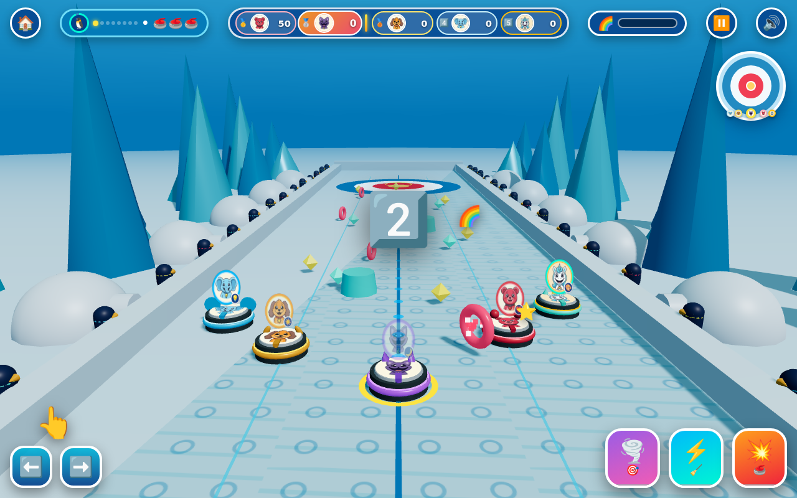

# 🐧🥌 Critter Ice Curling 3D: Penguin Glacier Knockout!

🎮 **Live Game URL**: https://kunruiw1991.github.io/critters-curling3d/

**Critter Ice Curling 3D: Penguin Glacier Knockout!** is a 3D WebGL Glacier Ice Curling & Knockout Shuffleboard game built with **Three.js (`js/vendor/three.min.js`)** featuring 8 selectable Smiling Critters, 8 sparkling glacier curling rinks, 3D stone-on-stone elastic knockouts, cheering 3D instanced penguins, soft directional shadows, and a 100% Zero-Text Visual Cockpit.

## 🌟 Key Features
- **8 Selectable Smiling Critters**: CatNap (`🌙`), DogDay (`☀️`), Bobby BearHug (`❤️`), PickyPiggy (`🍎`), Bubba Bubbaphant (`💡`), CraftyCorn (`🎨`), KickinChicken (`⭐`), and Hoppy Hopscotch (`⚡`) with custom 3D granite curling stones, 8 unique 3D ear/horn/crest sculptures, upright portrait medallions, and camera-facing distance billboard badges.
- **8 Distinct Glacier Rinks & Set-Pieces**:
  1. `🐧` **Penguin Bay**: Igloo Village domes & aqua patterned ice
  2. `❄️` **Frostbite Fjord**: Giant 6-pointed glowing snowflake monuments
  3. `🏔️` **Crystal Cavern**: Twin emerald alpine arches spanning the sheet
  4. `🐻‍❄️` **Polar Crown Arena**: Cheering 3D Polar Bear guardians & lavender paw-print ice
  5. `🌊` **Iceberg Drift Channel**: Shimmering turquoise ocean lagoon channels & wave arches
  6. `💎` **Diamond Aurora Sheet**: Rose-quartz ice & glowing magenta octahedron crystal clusters
  7. `🌨️` **Blizzard Peak Rink**: Swirling 3D snowfall particle vortex & wind pennants
  8. `👑` **Emperor Glacier Championship**: Grand golden royal archways & championship colonnade
- **3 Tactile Power Pedals + Rainbow Fever (`🌈`)**:
  - `Key 1` (`🌪️🎯`): **Bullseye Magnet Curl** — Homing magnetic curl straight toward the Golden Button.
  - `Key 2` / `Space` (`⚡🧹`): **Ice Broom Turbo Sweep** — Animated 3D brooms sweep the ice for high-speed glide.
  - `Key 3` (`💥🥌`): **Heavy Granite Knockout Stone** — Enlarges stone mass `2.85x` to knock rival stones out of the House (`+45 pts`).
- **Strict Top-3 Podium Qualification**: Finish **1st (`3⭐`)**, **2nd (`2⭐`)**, or **3rd (`1⭐`)** out of 5 Critters to unlock the next Glacier Rink (`8 stages total`). Finishing **4th or 5th (`0⭐`)** results in Defeat (`🔄` Retry only).

## 🎮 Controls & Scoring Summary
- **Steering & Curling**:
  - **Keyboard**: `⬅️ / ➡️` or `A / D` to curl left/right down the glacier sheet.
  - **Touch / Mouse**: Hold the giant `⬅️ / ➡️` cockpit buttons or drag anywhere on the 3D ice sheet using the translucent virtual joystick ring.
- **3 Power Pedals & Pause**:
  - `Key 1` (`🌪️🎯`): **Bullseye Magnet Curl** (`3.8s` cooldown, `2x` faster during Rainbow Fever `🌈🔥`)
  - `Key 2` / `Space` / `⬆️` / `W` (`⚡🧹`): **Ice Broom Turbo Sweep** (`2.6s` cooldown)
  - `Key 3` (`💥🥌`): **Heavy Granite Knockout Stone** (`4.4s` cooldown, `2.85x` mass)
  - `P` / `Esc` / `⏸️`: **Pause / Resume Modal**
- **Scoring & Rainbow Fever (`🌈`)**:
  - **House Rings**: Gold Button = `+100 pts` (`🎯`), Red Ring = `+50 pts` (`🎯`), White Ring = `+25 pts` (`⭐`), Blue Ring = `+10 pts` (`⭐`).
  - **Elastic Knockouts (`🥊`)**: `+30 pts` (`+45 pts` with Heavy Granite or Rainbow Fever) + `+26%` Fever charge.
  - **On-Ice Pickups & Bumper Shatters**: Stars (`+20 pts`), Ice Gems (`+35 pts`), Rainbow Rings (`+25 pts` + `+34%` Fever), Heavy/Fever Bumper Shatter (`+15 pts`).
  - **Rainbow Fever (`100% 🌈`)**: `1.5x` ring & pickup points, automatic magnet + broom boost, 7-color rainbow stone halo + trail, and `2x` Power Pedal cooldown recovery for `5.5s`.

## 🧪 10-Round Iterative Audit & Verification Changelog
- **Round 1 (3D WebGL Scene Architecture, Lighting/Shadows & Asset Loading)**:
  - Enabled `PCFSoftShadowMap` (`2048×2048` ortho frustum) and `ACESFilmicToneMapping` with per-stage `PMREMGenerator` sky environment maps, `BackSide` gradient sky dome (`skyTop`/`skyBot`), and a `420×420` snowfield ground plane under sideline penguins and iceberg spires.
  - Refactored all 28 penguins and 28 iceberg spires into `THREE.InstancedMesh` batches, shared all geometries/materials in `initSharedResources()` with `disposeTree()` cleanup so GPU geometry count stays flat across retries, and eliminated per-frame DOM `innerHTML` rebuilds in `updateHUD()`.
  - Added `THREE.LoadingManager` + procedural `CanvasTexture` portrait fallbacks with anisotropic filtering and decoupled `spinGroup` rotation so Critter portrait medallions stay upright at all times.
- **Round 2 (8 Smiling Critters Roster, Upright Medallions/Billboards & 8 Stage Themes)**:
  - Implemented deterministic per-stage rival rotation across all 8 Critters (with stage boss assignment and pink-pair separation + secondary rim stripes), `role="radiogroup"` / `role="radio"` accessibility, short-viewport responsive layout (`844×390`, `667×375`, `375×667`), and an interactive 3D Title-Scene Preview Stone at the House center.
  - Sculpted 8 distinct 3D ear/horn/crest geometries mounted on the forehead (`-z`) of `rootGroup`, moved the curling handle rearward (`z = +0.92..+1.05`) so it never occludes the portrait face, and added distance-adaptive `THREE.Sprite` portrait badges so House stones remain `≥ 44px` tall from the hack.
  - Retuned the follow camera (`20` behind, `y = 12`, looking `22` ahead) with `fog: false` horizon sky gradients, custom procedural ice surface patterns, wind pennant flags, and 8 unique 3D stage set-pieces.
- **Round 3 (Core 3D Physics, Critically Damped AI Lanes & Pooled Tactile Impact Layer)**:
  - Fixed `resolveStoneCollisions()` to identify the true `hitter` pre-impulse via approach velocity along the collision normal (`aIn >= bIn`), awarding `+30/+45` KO points strictly to the shooter and applying normal-aligned knockback to the struck stone.
  - Upgraded bumper collisions to true elastic restitution (`eB = 0.78`, `vn < 0` check, `0.25s` cooldown) and made Heavy/Fever bumper shatters a one-shot `+15` shatter event (`bmp.shattered = true`) with zero multi-frame grinding.
  - Replaced the undamped AI spring with a critically damped lateral controller (`k = 1.65, c = 2.57`) + real-time bumper avoidance.
  - Added a 100% pooled tactile impact layer: post-`lookAt` trauma camera shake + heavy KO hit-stop (`68ms`), 8 pooled shockwave rings, a 384-slot `THREE.Points` ice-shard/confetti burst system, 3D stone vertical knockback hop/tilt/landing squash, snowbank rebound puffs + thuds, and Bezier-arc flying star/KO/ring coins into HUD leaderboard chips.
- **Round 4 (100% Zero-Text Visual Cockpit, Predicted-Path Aim Dots & Responsive Touch Ergonomics)**:
  - Enforced a single-row non-wrapping top HUD bar with `tabular-nums` fixed-width score slots, compact landscape (`844×390`) and portrait (`390×844`, `360×640`) button sizing, `setPointerCapture` / `pointercancel` / `blur` input safety, a visual translucent drag-to-curl joystick ring, and a `⏸️` Pause overlay.
  - Added a `3️⃣-2️⃣-1️⃣-🥌` ready countdown, a conic wave timer ring around the stage icon, a `1.15s` House Settle camera payoff beat before advancing waves, `🥇🥈🥉` medal pips + a gold Top-3 qualification divider on the live rank strip, `.fever-active` `🔥` mode, and tactile pedal cooldown grayscale/bonk-shake/ready-pop/context-hint pulses.
  - Added 12 pooled 3D predicted-path aiming dots on the glacier ice (turning emerald/gold when the trajectory lands in the House rings) and a wordless ghost-finger (`👆`) tutorial on Stage 1.
- **Round 5 (3 Interactive Power Pedals, Continuous 3D Stone Visual Meshes/Trails & Rainbow Fever Mode)**:
  - Eliminated the `pointerdown` + `click` double-trigger on `.power-pedal` buttons (`if (e.detail > 0) return;` on `click`) so tapping or clicking a ready pedal never falsely triggers the cooldown bonk/shake immediately after activation.
  - Added continuous 3D visual meshes and particle trails to the sliding stone for all 3 Power Pedals and Rainbow Fever: dual counter-rotating 3D purple/cyan magnetic vortex rings + pull sparks for Pedal 1 (`🌪️`), animated dual 3D sweeping brooms for Pedal 2 (`⚡`), a pulsing fiery orange/gold 3D granite aura ring + ember sparks for Pedal 3 (`💥`), and a 7-color cycling rainbow stone halo + rainbow particle trail during Rainbow Fever (`🌈🔥`).
  - Expanded Rainbow Fever charging to reward rival stone knockouts (`+26%`) and House ring scores (`+18% / +30%`) in addition to on-ice pickups, and accelerated all 3 Power Pedal cooldown recovery rates by `2x` while Rainbow Fever is active.
- **Round 6 (4 Distinct AI Rival Roles, Longitudinal House Depth Control & Kid-Friendly Stage 1–8 Calibration)**:
  - Calibrated `STAGES` `aiSkill` progression (`0.48, 0.56, 0.64, 0.72, 0.79, 0.85, 0.91, 0.96`) and replaced hardcoded `houseTargets` with `(1 - effectiveSkill)` lateral spread and longitudinal stopping depth (`aiTargetZ`), ensuring Stage 1 is an easy, joyful 3-star win while Stages 2–8 progressively tighten toward the Red/Gold rings.
  - Differentiated the 4 AI Rivals into 4 lively roles (`boss`, `collector`, `guard`, `flanker`): the Stage Boss (`idx = 1`) leads speed and targets the button or settled player stones on Stages 4–8 with visible 3D broom sweeps, `collector` (`idx = 2`) bends toward mid-rink stars/gems on Stages 3+, and `guard` / `flanker` (`idx = 3, 4`) curl in from the wings to set up multi-stone chain knockouts.
  - Added gentle End 2/3 comeback rubber-banding when the player trails in 4th or 5th place so kids can mount exciting comebacks into the Top-3 Podium.
- **Round 7 (Strict 5-Critter Podium Cutline, Deterministic Tie-Breaking & Responsive Results Screen)**:
  - Added a visual Top-3 Qualification Cutline (`🏆 1–3 ⭐` vs `❄️ 4–5`) between 3rd (`🥉`) and 4th (`4️⃣`) on the 5-row podium, distinct `.victory-card` (golden glow + sequential `⭐` pop + 3D confetti burst) vs `.defeat-card` (frosty blue/red theme + pulsing jumbo `🔄` Retry button) styling, and per-racer knockout (`🥊`) badges.
  - Enforced kid-friendly deterministic tie-breaking (`score` -> `isPlayer` -> `knockouts`) in both `finishMatch()` and `updateHUD()`, guarded `#btn-next-stage` clicks with `if (!this.lastResult || !this.lastResult.qualified) return;`, and displayed a championship crown (`👑`) on Stage 8 Victory.
  - Added `@media (max-height: 540px)` and portrait mobile responsive rules for `#screen-results` (`max-height: calc(100dvh - 16px); overflow-y: auto;`) so all 5 podium rows, the qualification cutline, and action buttons fit 100% on-screen across `844×390`, `667×375`, and `375×667`.
- **Round 8 (Sample-Accurate Web Audio Synthesizer, Sad Trombone Glissando & Aspect-Aware Portrait FOV)**:
  - Upgraded `SoundFX.tone()` to sample-accurate `this.ctx.currentTime + delaySec` scheduling (eliminating `setTimeout` jitter), an `8ms` linear attack ramp (eliminating oscillator click pops), `osc.onended` node cleanup, a pitch-sliding sad trombone (`wah-wah-wah-waaaah` down to `182 Hz`) on Defeat, and dedicated `playKnockout()` (`🥊`) and `playCountdown()` (`3-2-1-🥌`) synth cues.
  - Added `audioEnabled` persistence in `localStorage`, startup `#btn-audio` icon sync, global first-gesture `AudioContext` unlock (`pointerdown`/`keydown`), and tab-visibility `AudioContext` suspend/resume.
  - Added aspect-aware portrait FOV scaling (`this.camera.fov = aspect < 1 ? Math.min(70, 52 / Math.max(0.68, aspect * 1.12)) : 52`) in `initThree()` so narrow portrait viewports (`390×844`, `360×640`) keep all 5 curling lanes (`x = ±10.2`) and sideline penguins in view without horizontal cropping, plus `100dvh` and `env(safe-area-inset-*)` HUD padding.
- **Round 9 (End-to-End Gameplay Polish, Pool & Overlay Reset Hygiene & Double-Score Guardrails)**:
  - Added `resetTransientPoolsAndOverlays()` invoked on `startStage()`, `exitToHome()`, and `finishMatch()` so in-flight `flyingCoinPool` DOM coins, `aimDotsPool`, `shockwavePool`, `countdownEl`, `tutorialHandEl`, `joystickEl`, `#hud-toast`, and Rainbow Fever halo colors are cleanly reset across screen transitions.
  - Explicitly zeroed `this.camera.rotation.z = 0` before applying post-`lookAt` trauma roll so camera tilt never lingers after collisions decay, and added a per-wave `this.waveScored` guard so calling `scoreHouseAndAdvanceWave()` during the `1.15s` settle beat never double-awards House ring points.

